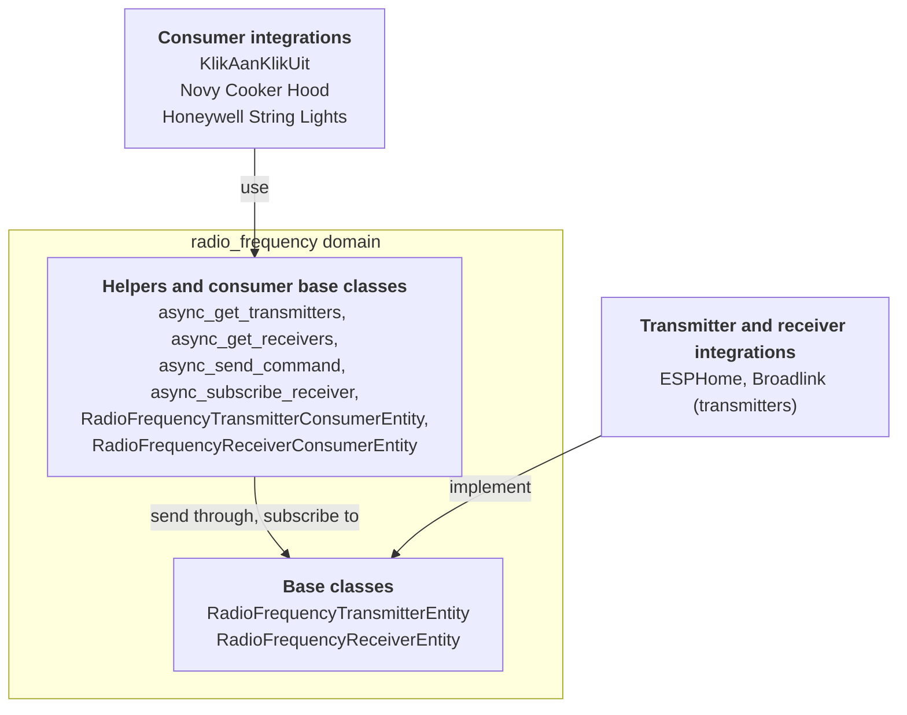

射频域位于射频硬件与其控制的设备之间。许多廉价设备会监听 433 MHz 或 868 MHz 的简单无线电编码：车库门、无线插座、灯串、抽油烟机。一个集成拥有无线电，例如 ESPHome 开发板或 Broadlink 集线器。另一个集成知道设备及其编码。射频域让它们无需了解彼此即可协同工作。

共有三种角色：

- **发射器集成**拥有发送射频信号的硬件。它们提供基于 `RadioFrequencyTransmitterEntity` 的实体。
- **接收器集成**拥有接收射频信号的硬件。它们提供基于 `RadioFrequencyReceiverEntity` 的实体。
- **消费方集成**知道设备及其编码。它们不创建射频实体。它们创建常规实体，例如[开关](/core/entities/switch/)或[灯](/core/entities/light/)，并通过用户选择的发射器或接收器发送或接收信号，通常是在配置流程中。

各角色如何通过射频域进行连接：



所有内容都位于 `homeassistant.components.radio_frequency` 中。命令来自 [`rf-protocols`](https://github.com/home-assistant-libs/rf-protocols) 库，该域重新导出了其 `RadioFrequencyCommand` 和 `ModulationType`。有关红外信号的相同模式，请参阅[红外实体](/core/entities/infrared/)。

## 属性

这些属性是射频实体特有的。每个实体都具有的通用属性请参见[实体类（entity class）](/core/entities/entity-class/)。

| 名称 | 类型 | 默认值 | 描述 |
| --- | --- | --- | --- |
| `supported_frequency_ranges` | `list[tuple[int, int]]` | 必填 | 硬件可以发射或接收的频率范围，以 `(min_hz, max_hz)` 元组表示。发射器和接收器都实现此属性。它是一个抽象属性：请将其实现为属性，而不是 `_attr_` 属性。 |

基类会为您设置一些内容：

| 名称 | 值 | 描述 |
| --- | --- | --- |
| `device_class` | `RadioFrequencyDeviceClass.TRANSMITTER` 或 `RadioFrequencyDeviceClass.RECEIVER` | 由基类设置。具有 `_attr_has_entity_name = True` 且没有名称的实体以其设备类别命名，例如 **射频接收器**。 |
| `should_poll` | `False` | 射频实体从不轮询。 |
| `state` | 最终 | 上次发送命令或接收信号的时间。请参阅[状态](#状态)。 |

两个基类都扩展了 `RestoreEntity`，因此上次的时间戳在重启后仍然保留。

## 支持的功能

射频实体没有支持的功能。实体要么是发射器，要么是接收器。如果您的硬件两者都支持，请分别创建一个实体。

实体能做什么由其频率范围和调制方式描述。目前，唯一的调制方式是 `ModulationType.OOK`（开关键控），并且假定每个发射器和接收器都支持它。

## 发射器

发射器需要实现两件事：频率范围，以及发送命令。

`async_send_command` 接收一个 `RadioFrequencyCommand`。从中读取您需要的内容：以赫兹为单位的 `frequency`、`modulation`、`repeat_count`、可选的 `symbol_rate` 和 `output_power`，以及 `get_raw_timings()`，它以微秒为单位将信号返回为交替的脉冲（正值）和间隔（负值）。发送失败时抛出 `HomeAssistantError`。

不要从其他代码中调用实体上的 `async_send_command`。消费方应通过 `async_send_command` 辅助函数，它会检查频率和调制方式、传递上下文，并在成功发送后更新状态。

## 接收器

接收器仅实现频率范围。没有用于接收的方法：当您的硬件接收到信号时，请通过 `_handle_received_signal` 将其交给基类。基类将状态设置为接收信号的时间，并调用每个订阅者。

```python
class MyRfReceiver(RadioFrequencyReceiverEntity):
    @property
    def supported_frequency_ranges(self) -> list[tuple[int, int]]:
        """Return the bands this radio can receive on."""
        return [(433_050_000, 434_790_000)]

    @callback
    def _on_hardware_signal(self, timings: list[int], frequency: int) -> None:
        """Pass a signal from the hardware on to subscribers."""
        self._handle_received_signal(
            RadioFrequencyReceivedSignal(timings=timings, frequency=frequency)
        )
```

`RadioFrequencyReceivedSignal` 包含 `timings`（一个 `int` 列表）、可选的 `frequency` 以及 `modulation`（默认为 `ModulationType.OOK`）。请从事件循环中调用 `_handle_received_signal`。

## 消费方辅助函数

消费方从不持有对射频实体的引用。它们使用实体 ID（或其注册表 ID）以及这些辅助函数：

| 辅助函数 | 描述 |
| --- | --- |
| `async_get_transmitters(hass, frequency, modulation)` | 所有支持该频率和调制方式的发射器的实体 ID。空列表表示没有合适的发射器。当域未加载或根本没有发射器时，抛出 `HomeAssistantError`。 |
| `async_get_receivers(hass, frequency, modulation)` | 所有支持该频率和调制方式的接收器的实体 ID。空列表表示没有合适的接收器。当域未加载或根本没有接收器时，抛出 `HomeAssistantError`。 |
| `async_send_command(hass, entity_id_or_uuid, command, context=None)` | 通过发射器发送命令。当域未加载、发射器不存在或它不支持命令的频率或调制方式时，抛出 `HomeAssistantError`。 |
| `async_subscribe_receiver(hass, entity_id_or_uuid, signal_callback)` | 为每个信号调用 `signal_callback`，并传入一个 `RadioFrequencyReceivedSignal`。返回一个用于取消订阅的回调。当域未加载或接收器不存在时，抛出 `HomeAssistantError`。 |

大多数消费方不需要直接使用辅助函数，因为两个基类会为它们处理簿记工作：

- `RadioFrequencyTransmitterConsumerEntity`：将 `_rf_transmitter_entity_id` 设置为发射器的实体 ID，并调用 `await self._send_command(command)`。基类仅在发射器可用时保持您的实体可用，并传递操作的上下文。
- `RadioFrequencyReceiverConsumerEntity`：将 `_rf_receiver_entity_id` 设置为接收器的实体 ID，并实现 `_handle_signal(signal)` 回调。基类仅在接收器可用时保持您的实体可用，并在您的实体可用时订阅接收器。
- 两个基类，用于发送和接收的实体：同时设置两个实体 ID。基类仅在发射器和接收器都可用时保持您的实体可用，因此当发射器不可用时，它也会停止接收。

将它们混合在您平台的实体类之前，例如 `class MySocket(RadioFrequencyTransmitterConsumerEntity, SwitchEntity)`。当您覆盖 `_async_rf_availability_changed(available)` 以响应可用性时，请调用 `super()`，以便基类仍然更新可用性和订阅。

对于配置流程和前端，还有一个 `radio_frequency/list` WebSocket 命令（仅限管理员）。它返回两个列表：`transmitters` 和 `receivers`。每个条目描述一个实体及其设备、配置条目、频率范围和支持的调制方式。

## 方法

| 方法 | 描述 |
| --- | --- |
| `async_send_command(command)` | 发射器必需。在空中发送命令。没有同步变体。接收器不实现它。 |
| `supported_frequency_ranges` | 必需属性。返回 `(min_hz, max_hz)` 范围。 |

`supports_frequency` 和 `supports_modulation` 是最终的：基类根据频率范围和调制方式来实现它们。

## 状态

发射器的状态是上次发送命令的时间。接收器的状态是上次接收信号的时间。两者都是带毫秒的 ISO 8601 时间戳，例如 `2026-10-10T08:15:00.123+00:00`，或者在第一次之前为 `unknown`。状态是最终的：基类管理它。

## 示例

网络集线器上一个 433 MHz 无线电的发射器。

```python
from homeassistant.components.radio_frequency import (
    RadioFrequencyCommand,
    RadioFrequencyTransmitterEntity,
)
from homeassistant.exceptions import HomeAssistantError


class MyRfTransmitter(RadioFrequencyTransmitterEntity):
    """The 433 MHz radio of a hub."""

    _attr_has_entity_name = True
    _attr_translation_key = "rf_transmitter"

    def __init__(self, hub: MyHub) -> None:
        """Initialize the transmitter."""
        self._hub = hub
        self._attr_unique_id = f"{hub.serial}_rf"

    @property
    def supported_frequency_ranges(self) -> list[tuple[int, int]]:
        """Return the bands this radio can transmit on."""
        return [(433_050_000, 434_790_000)]

    async def async_send_command(
        self, command: RadioFrequencyCommand
    ) -> None:
        """Send the command."""
        try:
            await self._hub.send_rf(
                frequency=command.frequency,
                timings=command.get_raw_timings(),
                repeat=command.repeat_count,
            )
        except MyHubError as err:
            raise HomeAssistantError(f"Sending failed: {err}") from err
```

在消费方一侧，无线插座的开关只需在 `RadioFrequencyTransmitterConsumerEntity` 之上再写几行代码：

```python
from typing import Any

from rf_protocols.commands.kaku import KakuCommand

from homeassistant.components.radio_frequency import (
    RadioFrequencyTransmitterConsumerEntity,
)
from homeassistant.components.switch import SwitchEntity


class MySocket(RadioFrequencyTransmitterConsumerEntity, SwitchEntity):
    """A wireless socket that listens to KlikAanKlikUit codes."""

    _attr_has_entity_name = True
    _attr_name = None
    _attr_assumed_state = True

    def __init__(
        self, entry_id: str, transmitter: str, code: int, channel: int
    ) -> None:
        """Initialize the socket."""
        self._attr_unique_id = entry_id
        self._rf_transmitter_entity_id = transmitter
        self._code = code
        self._channel = channel

    async def async_turn_on(self, **kwargs: Any) -> None:
        """Send the on code."""
        await self._send_command(
            KakuCommand(
                id=self._code, group=False, channel=self._channel, on=True
            )
        )
        self._attr_is_on = True
        self.async_write_ha_state()

    async def async_turn_off(self, **kwargs: Any) -> None:
        """Send the off code."""
        await self._send_command(
            KakuCommand(
                id=self._code, group=False, channel=self._channel, on=False
            )
        )
        self._attr_is_on = False
        self.async_write_ha_state()
```
