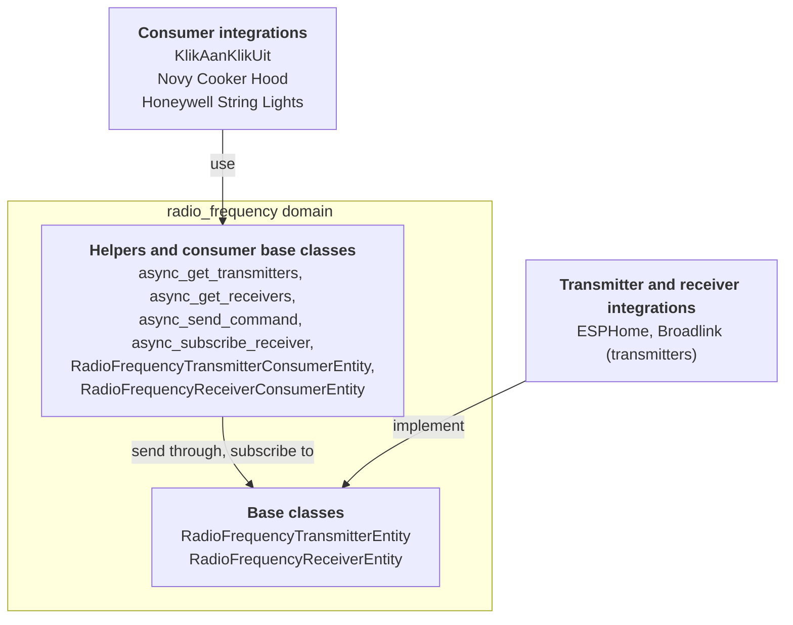

The radio frequency domain sits between RF hardware and the devices it controls. Plenty of cheap devices listen to simple radio codes on 433 MHz or 868 MHz: garage doors, wireless sockets, string lights, cooker hoods. One integration owns the radio, like an ESPHome board or a Broadlink hub. Another integration knows a device and its codes. The radio frequency domain lets them work together without knowing about each other.

There are three roles:

- **Transmitter integrations** own hardware that sends RF signals. They provide an entity based on `RadioFrequencyTransmitterEntity`.
- **Receiver integrations** own hardware that picks up RF signals. They provide an entity based on `RadioFrequencyReceiverEntity`.
- **Consumer integrations** know a device and its codes. They do not create radio frequency entities. They create regular entities, like a [switch](/core/entities/switch/) or a [light](/core/entities/light/), and send or receive through a transmitter or receiver the user picked, usually in the config flow.

各角色如何通过射频域进行连接：



Everything lives in `homeassistant.components.radio_frequency`. The commands come from the [`rf-protocols`](https://github.com/home-assistant-libs/rf-protocols) library, and the domain re-exports its `RadioFrequencyCommand` and `ModulationType`. For the same pattern with infrared signals, see the [infrared entity](/core/entities/infrared/).

## 属性

这些属性是射频实体特有的。每个实体都具有的通用属性请参见[实体类（entity class）](/core/entities/entity-class/)。

| 名称 | 类型 | 默认值 | 描述 |
| --- | --- | --- | --- |
| `supported_frequency_ranges` | `list[tuple[int, int]]` | Required | The frequency ranges the hardware can transmit or receive on, as `(min_hz, max_hz)` tuples. Transmitters and receivers both implement it. It is an abstract property: implement it as a property, not as an `_attr_` attribute. |

The base classes set a few things for you:

| Name | Value | Description |
| --- | --- | --- |
| `device_class` | `RadioFrequencyDeviceClass.TRANSMITTER` or `RadioFrequencyDeviceClass.RECEIVER` | Set by the base class. An entity with `_attr_has_entity_name = True` and no name is named after its device class, like **Radio frequency receiver**. |
| `should_poll` | `False` | Radio frequency entities never poll. |
| `state` | Final | The time of the last command sent or signal received. See [States](#states). |

Both base classes extend `RestoreEntity`, so the last timestamp survives a restart.

## 支持的功能

Radio frequency entities have no supported features. An entity is either a transmitter or a receiver. If your hardware does both, create one entity of each.

What an entity can do is described by its frequency ranges and its modulation. Right now, the only modulation is `ModulationType.OOK` (on-off keying), and every transmitter and receiver is assumed to support it.

## 发射器

发射器需要实现两件事：频率范围，以及发送命令。

`async_send_command` 接收一个 `RadioFrequencyCommand`。从中读取你需要的内容：以赫兹为单位的 `frequency`、`modulation`、`repeat_count`、可选的 `symbol_rate` 和 `output_power`，以及 `get_raw_timings()`，它以微秒为单位将信号返回为交替的脉冲（正值）和间隔（负值）。发送失败时抛出 `HomeAssistantError`。

不要从其他代码中调用实体上的 `async_send_command`。消费方应通过 `async_send_command` 辅助函数，它会检查频率和调制方式、传递上下文，并在成功发送后更新状态。

## Receiver

A receiver implements only the frequency ranges. There is no method to implement for receiving: when your hardware picks up a signal, hand it to the base class with `_handle_received_signal`. The base class sets the state to the time the signal was received and calls every subscriber.

```python
class MyRfReceiver(RadioFrequencyReceiverEntity):
    @property
    def supported_frequency_ranges(self) -> list[tuple[int, int]]:
        """Return the bands this radio can receive on."""
        return [(433_050_000, 434_790_000)]

    @callback
    def _on_hardware_signal(self, timings: list[int], frequency: int) -> None:
        """Pass a signal from the hardware on to subscribers."""
        self._handle_received_signal(
            RadioFrequencyReceivedSignal(timings=timings, frequency=frequency)
        )
```

`RadioFrequencyReceivedSignal` holds `timings` (a list of `int`), an optional `frequency`, and `modulation`, which defaults to `ModulationType.OOK`. Call `_handle_received_signal` from the event loop.

## Consumer helpers

Consumers never hold a reference to a radio frequency entity. They work with an entity ID (or its registry ID) and these helpers:

| 辅助函数 | 描述 |
| --- | --- |
| `async_get_transmitters(hass, frequency, modulation)` | The entity IDs of all transmitters that support the frequency and modulation. An empty list means none of them fit. Raises `HomeAssistantError` when the domain is not loaded or there are no transmitters at all. |
| `async_get_receivers(hass, frequency, modulation)` | The entity IDs of all receivers that support the frequency and modulation. An empty list means none of them fit. Raises `HomeAssistantError` when the domain is not loaded or there are no receivers at all. |
| `async_send_command(hass, entity_id_or_uuid, command, context=None)` | Sends a command through a transmitter. Raises `HomeAssistantError` when the domain is not loaded, the transmitter does not exist, or it does not support the frequency or modulation of the command. |
| `async_subscribe_receiver(hass, entity_id_or_uuid, signal_callback)` | Calls `signal_callback` with a `RadioFrequencyReceivedSignal` for every signal. Returns a callback to unsubscribe. Raises `HomeAssistantError` when the domain is not loaded or the receiver does not exist. |

Most consumers do not need the helpers directly, because two base classes do the bookkeeping for them:

- `RadioFrequencyTransmitterConsumerEntity`: set `_rf_transmitter_entity_id` to the entity ID of the transmitter and call `await self._send_command(command)`. The base class keeps your entity available only while the transmitter is available, and passes on the context of the action.
- `RadioFrequencyReceiverConsumerEntity`: set `_rf_receiver_entity_id` to the entity ID of the receiver and implement the `_handle_signal(signal)` callback. The base class keeps your entity available only while the receiver is available, and subscribes to the receiver while your entity is available.
- Both base classes, for an entity that sends and receives: set both entity IDs. The base classes keep your entity available only while the transmitter and the receiver are both available, so it also stops receiving while the transmitter is unavailable.

Mix them in before the entity class of your platform, like `class MySocket(RadioFrequencyTransmitterConsumerEntity, SwitchEntity)`. When you override `_async_rf_availability_changed(available)` to react to availability, call `super()`, so the base classes still update the availability and the subscription.

For config flows and the frontend, there is also a `radio_frequency/list` WebSocket command (admin only). It returns two lists, `transmitters` and `receivers`. Each entry describes one entity with its device, config entry, frequency ranges, and supported modulations.

## 方法

| 方法 | 描述 |
| --- | --- |
| `async_send_command(command)` | Required for transmitters. Send the command over the air. There is no sync variant. Receivers do not implement it. |
| `supported_frequency_ranges` | Required property. Return the `(min_hz, max_hz)` ranges. |

`supports_frequency` 和 `supports_modulation` 是 final 的：基类根据频率范围和调制方式来实现它们。

## 状态

The state of a transmitter is the time the last command was sent. The state of a receiver is the time the last signal was received. Both are ISO 8601 timestamps with milliseconds, like `2026-10-10T08:15:00.123+00:00`, or `unknown` before the first one. The state is final: the base classes manage it.

## 示例

网络集线器上一个 433 MHz 无线电的发射器。

```python
from homeassistant.components.radio_frequency import (
    RadioFrequencyCommand,
    RadioFrequencyTransmitterEntity,
)
from homeassistant.exceptions import HomeAssistantError


class MyRfTransmitter(RadioFrequencyTransmitterEntity):
    """The 433 MHz radio of a hub."""

    _attr_has_entity_name = True
    _attr_translation_key = "rf_transmitter"

    def __init__(self, hub: MyHub) -> None:
        """Initialize the transmitter."""
        self._hub = hub
        self._attr_unique_id = f"{hub.serial}_rf"

    @property
    def supported_frequency_ranges(self) -> list[tuple[int, int]]:
        """Return the bands this radio can transmit on."""
        return [(433_050_000, 434_790_000)]

    async def async_send_command(
        self, command: RadioFrequencyCommand
    ) -> None:
        """Send the command."""
        try:
            await self._hub.send_rf(
                frequency=command.frequency,
                timings=command.get_raw_timings(),
                repeat=command.repeat_count,
            )
        except MyHubError as err:
            raise HomeAssistantError(f"Sending failed: {err}") from err
```

在消费方一侧，无线插座的开关只需在 `RadioFrequencyTransmitterConsumerEntity` 之上再写几行代码：

```python
from typing import Any

from rf_protocols.commands.kaku import KakuCommand

from homeassistant.components.radio_frequency import (
    RadioFrequencyTransmitterConsumerEntity,
)
from homeassistant.components.switch import SwitchEntity


class MySocket(RadioFrequencyTransmitterConsumerEntity, SwitchEntity):
    """A wireless socket that listens to KlikAanKlikUit codes."""

    _attr_has_entity_name = True
    _attr_name = None
    _attr_assumed_state = True

    def __init__(
        self, entry_id: str, transmitter: str, code: int, channel: int
    ) -> None:
        """Initialize the socket."""
        self._attr_unique_id = entry_id
        self._rf_transmitter_entity_id = transmitter
        self._code = code
        self._channel = channel

    async def async_turn_on(self, **kwargs: Any) -> None:
        """Send the on code."""
        await self._send_command(
            KakuCommand(
                id=self._code, group=False, channel=self._channel, on=True
            )
        )
        self._attr_is_on = True
        self.async_write_ha_state()

    async def async_turn_off(self, **kwargs: Any) -> None:
        """Send the off code."""
        await self._send_command(
            KakuCommand(
                id=self._code, group=False, channel=self._channel, on=False
            )
        )
        self._attr_is_on = False
        self.async_write_ha_state()
```
