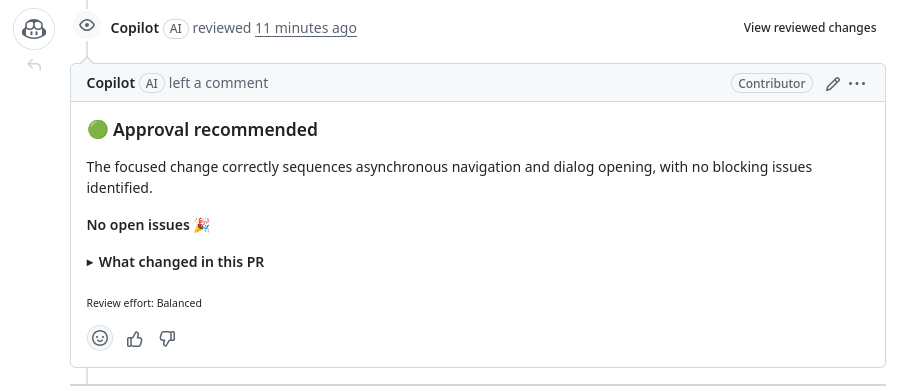

你的更改已生效，并且[检查](/frontend/development/testing/)已通过。以下是维护者查看你的拉取请求之前需要满足的条件。每个仓库的通用步骤见[拉取请求与审查](/start/pull-requests/)。

## 在准备好审查时打开

当你的更改完成并希望获得审查时，再打开拉取请求，而不是为了尝试某些内容。

每个拉取请求都会占用分类、标记和审查人员的时间，即使是草稿也是如此。若要试验，请推送到你的[复刻（fork）](/glossary/fork/)中的分支。你可以在那里查看结果，而无需打开任何内容。

如果打开后 CI 失败，请修复它。[通用指南](/start/pull-requests/#the-bots-go-first)说明了在此期间何时将其标记为草稿。

## 写一个简短的标题

标题用几个词告诉维护者更改了什么。它也会出现在发布说明中。请使其简短而有意义：

- 好：“修复不可用实体的磁贴卡片图标颜色”
- 好：“为标签选择器添加搜索功能”
- 不推荐：“修复错误”、“更新 hui-tile-card.ts”或“更改”

## 填写模板

使用[拉取请求模板](https://github.com/home-assistant/frontend/blob/dev/.github/PULL_REQUEST_TEMPLATE.md)。逐节填写，并且只删除模板指示在不适用时删除的部分。如果模板缺失或不完整，检查将失败，如[审查与发布](/frontend/development/review-and-release/#before-review)所述。

- **破坏性更改**：如果你的更改对现有用户造成了破坏，请告诉他们破坏了什么、如何恢复，以及原因。请面向用户撰写，而不是面向维护者。如果没有破坏任何内容，请删除该部分。
- **提议的更改**：描述更改了什么以及原因，以便审查者获得概览。几句话就足够了。不要逐行描述代码：差异（diff）已经展示了这些。如果你使用 AI 工具，不要让它们为你写冗长的描述。请用自己的话撰写。
- **截图**：对于任何可见的更改，请添加前后截图或短视频。如果没有可见更改，请删除该部分。
- **更改类型**：只勾选一个框。如果需要两个，请拆分拉取请求。
- **附加信息**：链接它修复的问题，以及任何相关的后端或文档拉取请求。
- **检查清单**：勾选真实适用的框。只有你能说明你理解代码并已测试过。

## 处理 Copilot 审查

打开拉取请求后，GitHub Copilot 会进行首次审查并留下评论。审查以摘要开头，例如这个拉取请求的示例，其中它没有发现需要修复的问题：

- 如果评论有道理，请修复并推送。
- 如果没有，请回复评论并解释原因。这样，维护者会看到你已经查看过，并知道你为何保留它。

不要留下未回复的 Copilot 评论。维护者在审查时会阅读这些回复。
